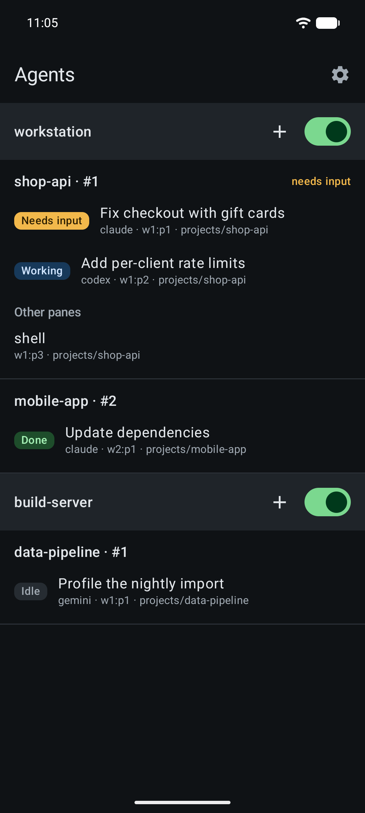
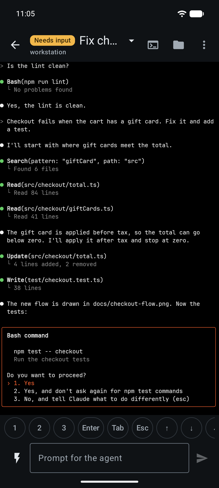
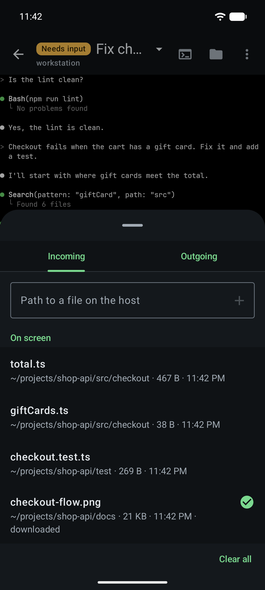
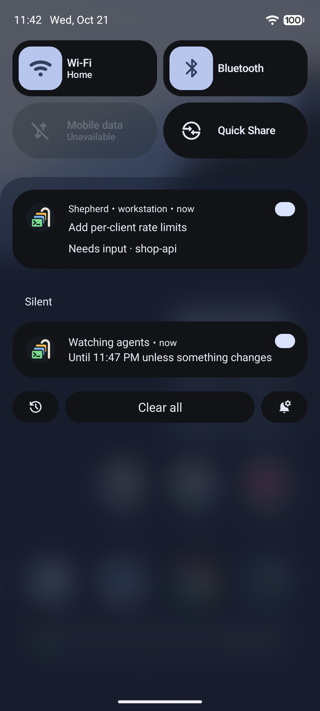

# Shepherd

An Android client for [herdr](https://github.com/herdrdev/herdr), the terminal workspace manager for AI coding agents.
It connects to the herdr machine over SSH and talks to herdr's API through a forwarded Unix socket: nothing to install
on the host, no cloud, no backend. On a phone set to Russian the app speaks Russian and is called «Пастух».

<p>
  
  
  
  
</p>

All the screenshots are in [docs/screenshots](docs/screenshots).

## Features

- All agents of all your servers in one list, with their status: needs input, working, done, idle.
- Answer an agent with one tap (1/2/3, Enter, Tab, Esc, arrows, Shift, Ctrl, Alt, Ctrl+C, Home, End, PgUp, PgDn) or
  send it a prompt. Ctrl+Enter sends a prompt to Claude Code at once, as in its terminal: a prompt sent while Claude
  works doesn't wait for the end of its turn.
- Shift, Ctrl and Alt work with every key, from the row, the soft keyboard or a hardware one, on the agent screen and
  in the terminal: Ctrl+Shift+C reaches Claude Code as itself and a shell as Ctrl+C, the way a desktop terminal sends
  them. With the Russian layout, Ctrl and Alt take the Latin key of the letter.
- Snippets for the prompt: text you send often, such as `/effort max`, saved once and put in from a menu. A snippet can
  also go on its own to each new session of a chosen agent that you start from the app, once the agent is ready.
- Notifications when an agent needs input or finishes, with the phone locked too.
- A full terminal for any pane.
- Web links on the screen open in the phone's browser with a tap, on the agent screen and in the terminal.
- Files: download a file the agent mentions on screen, such as a screenshot or an APK, and open it; send files from
  the phone to the machine. The files window lists the files of its pane or of the pane's whole workspace.
- Share to Shepherd from any app: pick an agent, and shared text goes into its prompt, shared files go to the machine
  with their paths after the text.
- Start an agent from the phone: in a new tab next to another agent, or from the list in any folder of the machine,
  in a session without panes too. Close a pane.
- Several servers: a server is a host, a user and a herdr session.

## Requirements

- herdr 0.9.5 or newer on the machine, and SSH access to it.
- Android 13 or newer. The phone has to reach the machine: home network or VPN.

## Setup

1. Build the APK (see [Build](#build)) and install it, for example with
   `adb install -r app/build/outputs/apk/release/app-release.apk`.
2. On the first start the app opens the server form: the machine's address, user, path to herdr and session; the name
   is optional. *Create key* there makes the phone's key. Add its line to `~/.ssh/authorized_keys` on the machine,
   preferably restricted: `no-agent-forwarding,no-X11-forwarding ssh-ed25519 AAAA… herdr-android@<model>`.
3. *Save* leads to the agent list, where the server connects and shows its host key fingerprint. Compare it with
   `ssh-keygen -lf /etc/ssh/ssh_host_ed25519_key.pub` on the machine. *Cancel* switches the server off; switched on
   again, it asks again.
4. Once a server is connected, the app asks once for permission to show notifications.

If the app asks to restart the herdr server, the herdr CLI and server are different versions: the terminal works only
when they match. Restart the server when the agents are idle.

## Security

- The phone's SSH key is made on the phone and kept encrypted with an Android Keystore key that never leaves it. App
  backups are off.
- A server's host key is pinned once you have compared its fingerprint; if it changes, the app stops connecting.
- The app reads the screen and sends keys and prompts; it starts agents, in a tab or a workspace of their own, and
  closes panes only when you tap. It never moves the focus on the desktop. On the host it reads files and writes only
  to `herdr-android` in the downloads folder (`~/Downloads/herdr-android/` or its XDG counterpart).

## Build

JDK 21 and the Android SDK (compileSdk 37); the SDK path goes into `local.properties` (`sdk.dir=…`).

```sh
./gradlew build                   # build and unit tests
./gradlew :app:assembleDebug      # debug APK: app/build/outputs/apk/debug/
./gradlew :app:assembleRelease    # release APK: app/build/outputs/apk/release/
```

The debug APK (package `dev.artalex.herdr.debug`) needs no signing setup. The release build is minified with R8 and
signed with a key kept outside the repository. The Gradle property `herdr.signing` points to its properties, by default
`~/.android-keys/herdr-release.properties`:

```properties
storeFile=/home/<user>/.android-keys/herdr-release.jks
storePassword=…
keyAlias=herdr
keyPassword=…
```

Without it the release APK comes out unsigned. Keep the key backed up: Android installs an update over the old version
only if the update is signed with the same key.

## Tests

```sh
./gradlew check            # unit tests, :core integration tests against a throwaway herdr server, lint
./scripts/e2e.sh           # the app on an emulator connects over SSH to herdr on this machine
./scripts/e2e.sh --release # the same tests on the minified, signed release build
./scripts/screenshots.sh   # screenshots of a staged demo scene, into docs/screenshots/
```

Integration and e2e tests need herdr 0.9.5 or newer and a dedicated SSH test key that sshd accepts from localhost
only: a line in `~/.ssh/authorized_keys` with `from="127.0.0.1,::1"` (the key's path is `HERDR_SSH_TEST_KEY`, by
default `~/.ssh/herdr_android_test`). The emulator reaches the host as 10.0.2.2, and its connections arrive from
127.0.0.1.

`scripts/e2e.sh` starts the AVD `herdr-e2e` (`HERDR_AVD`) without a window or GPU, and three throwaway herdr sessions:
`hdr-e2e`, `hdr-e2e2` standing for a second server, and `hdr-e2e-stop`, whose server a test stops and starts again.
It runs on an emulator only, never on a phone
connected to adb, and saves screenshots to `app/build/e2e-screens/`. No real agent runs: a `claude` that echoes its
input comes first in PATH, and herdr takes it for Claude Code. The notification and key tests lock the emulator with
the PIN `1111` for a while; if a run dies halfway, `adb shell locksettings clear --old 1111` removes it.
`scripts/screenshots.sh` stages its scene in `~/projects` on this machine for the run, so there must be none.

Instrumented tests run in the app's process and take shared libraries from it. So for the release run R8 also keeps
whatever the tests reference, with rules from R8 TraceReferences (task `traceReleaseTestReferences`). The APK for
phones is built without them.

## Development notes

- `:core` is plain Kotlin/JVM: the herdr protocol, transport and polling, tested without Android. `:app` is the Android
  app on Jetpack Compose.
- Strings live in `app/src/main/res/values/strings.xml` (English, the default) and `values-ru/strings.xml`; a new
  string goes into both. The APK carries the libraries' strings in these two languages only.
- `scripts/launcher_icon.py` generates the launcher icon layers and the notification icon from one geometry: edit the
  script, not the XML. With `--preview <file.html>` it also draws the icon in round and squircle masks with the 66 dp
  safe zone.
- The agent screen and the terminal use the bundled JetBrains Mono 2.304: on some phones the system monospace font
  is proportional.

## License

The code is under 0BSD (`LICENSE`): use, change and share it without any conditions. JetBrains Mono comes with its own
license, OFL 1.1 (`app/src/main/assets/licenses/JetBrainsMono-OFL.txt`).
